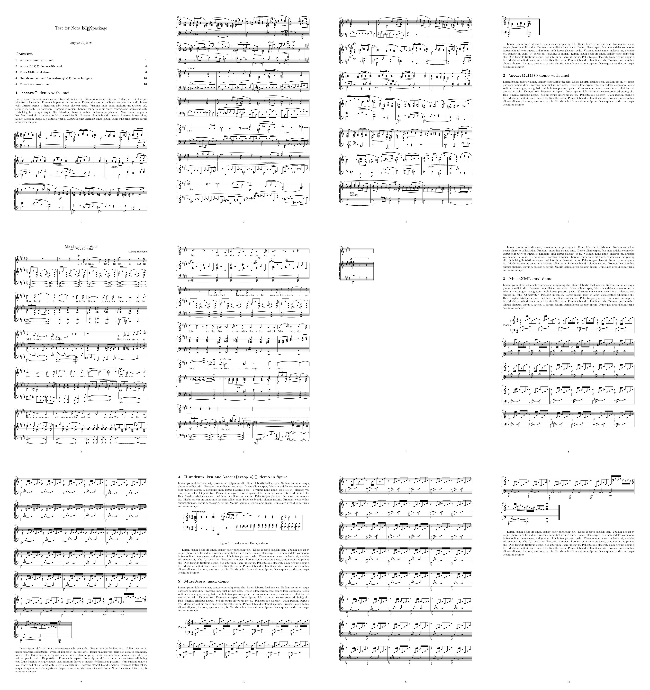

# Nota

## Intro

**Nota brings engraved music notation into LaTeX documents.** It is intended
for articles, teaching material, musicological examples, critical editions,
and other documents where scores need to sit naturally beside text.

Instead of exporting and cropping a new graphic after every musical edit, add
the score file to your project and write `\score{file.mei}`. Nota measures the
space available in LaTeX and engraves the music for that space. The document
still controls its margins, columns, page breaks, and surrounding text.

Nota accepts MEI, MusicXML, Humdrum, ABC, Plaine & Easie, and MuseScore files.

## Demo

[](showcase/pdf/a4-article.pdf)

The image above is a contact sheet of the complete
[A4 article demo](showcase/pdf/a4-article.pdf). It includes music flowing between
paragraphs, full-page scores, a short example inside a figure, and several
score formats.

There is also an [A3 two-sided book demo](showcase/pdf/a3-twoside.pdf) with
asymmetric margins, larger notation, and a two-column passage. Both PDFs are
generated from the LaTeX sources in `examples/latex/`.

## Usage

Load the package and include a score:

```tex
\documentclass{article}
\usepackage{nota}

\begin{document}

Text before the music.

\score{opening.mei}

Text after the music.

\end{document}
```

### Score layouts

```tex
\score{piece.mei}          % systems flow between the surrounding text
\score[full]{piece.mei}    % full score pages inside the LaTeX document
\score[example]{motif.krn} % one compact example, suitable for a figure
```

The default layout renders each system separately, allowing LaTeX to break a
long score across pages. `full` creates pages as tall as the document's text
area. `example` keeps the breaks encoded in the score and crops the output to
the musical excerpt.

### Options

**`font`**

- Description: Music font passed to Verovio. The default is `Leipzig`.
- Values: `Leipzig`, `Bravura`, `Gootville`, `Leland`, `Petaluma`, or another
  font installed for Verovio.
- Example: `\score[font=Leland]{piece.mei}`

**`unit`**

- Description: Staff size. One unit is half the distance between two staff
  lines. When omitted, Nota scales it from the current LaTeX font size.
- Values: A number from `4.5` to `12`.
- Example: `\score[unit=8]{piece.mei}`

**`indent`**

- Description: Indents only the first system of the default, in-flow layout.
  The default is no indent.
- Values: Any TeX dimension smaller than the current line width.
- Example: `\score[indent=15pt]{piece.mei}`

**`full`**

- Description: Uses full-page score layout. It is a flag, not a key-value
  option.
- Values: No value.
- Example: `\score[full]{piece.mei}`

**`example`**

- Description: Preserves encoded breaks and produces a compact excerpt. It is
  a flag, not a key-value option.
- Values: No value.
- Example: `\score[example]{motif.krn}`

`font`, `unit`, and `indent` can be set in three places:

```tex
\usepackage[font=Leipzig, unit=7]{nota} % document default

\begingroup
  \notasetup{font=Leland, unit=8}       % until this TeX group ends
  \score{chapter.mei}
\endgroup

\score[font=Bravura, unit=6]{piece.mei} % this score only
```

The setting nearest to `\score` wins. `full` and `example` can be used on an
individual score or inside a grouped `\notasetup`; they are not package
options.

### Score formats

Nota supports the formats accepted by Verovio, including:

- MEI: `.mei`
- MusicXML: `.musicxml`, `.xml`, `.mxl`
- Humdrum: `.krn`
- ABC: `.abc`
- Plaine & Easie: `.pae`
- MuseScore: `.mscz` when the MuseScore CLI is installed

## How to install and run

Nota is not on CTAN yet, so install it from the repository.

You need:

- LaTeX 2022-06-01 or newer with `graphicx`
- [Verovio](https://www.verovio.org/) on `PATH`
- `rsvg-convert` from [librsvg](https://gitlab.gnome.org/GNOME/librsvg)
- Go 1.22 or newer to build the renderer
- MuseScore's `mscore` command only for `.mscz` input

Clone and install Nota into your local TeX tree and `~/.local/bin`:

```sh
git clone https://github.com/manolisky/nota.git
cd nota
make install-local
```

Make sure `~/.local/bin` is on `PATH`, then check the installation:

```sh
kpsewhich nota.sty
nota-render --version
```

Compile a document with:

```sh
xelatex paper.tex
nota-render paper
xelatex paper.tex
xelatex paper.tex
```

The first LaTeX pass records the scores. `nota-render` engraves them. The later
LaTeX passes include the generated music and settle references. Output is kept
in `paper-nota/`, and unchanged scores are reused from the render cache.

## How it's made and technologies used

Nota separates document layout from music engraving:

1. The LaTeX package measures `\linewidth`, `\textheight`, and the current font
   size when it reaches each `\score` command.
2. It writes those measurements and the score request to
   `<jobname>.nota.aux`.
3. The Go renderer reads the requests and invokes Verovio for each score.
4. Verovio engraves canonical SVG pages using SMuFL music fonts.
5. librsvg converts the SVG pages to PDF for LaTeX's `graphicx` package.
6. Later LaTeX passes place the generated pages in the document.

The main technologies are:

- **LaTeX** for document layout, page breaking, and final typesetting
- **Go** for the `nota-render` command, caching, and concurrent rendering
- **Verovio** for music engraving and score-format conversion
- **SMuFL** for standardized music symbols and fonts
- **SVG and PDF** for portable, vector score graphics

Rendering is a separate build step, so Nota does not require
`--shell-escape`.
